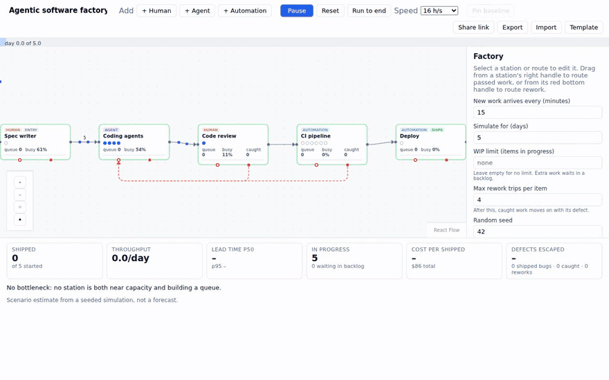
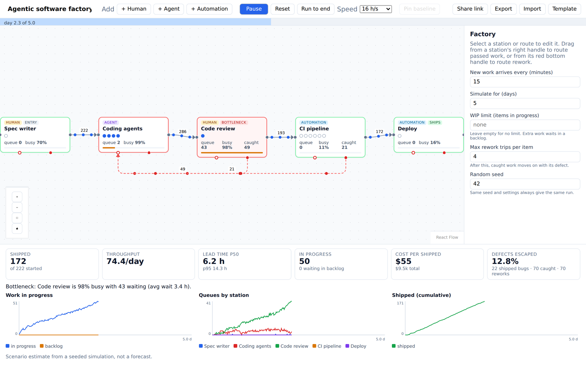
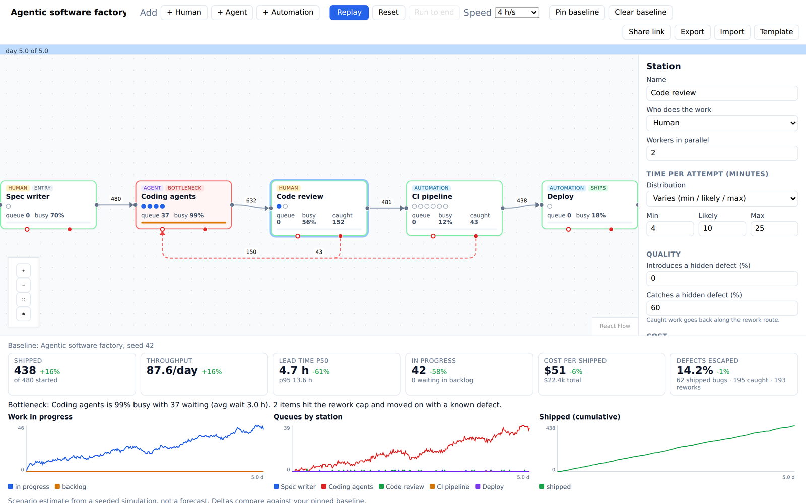
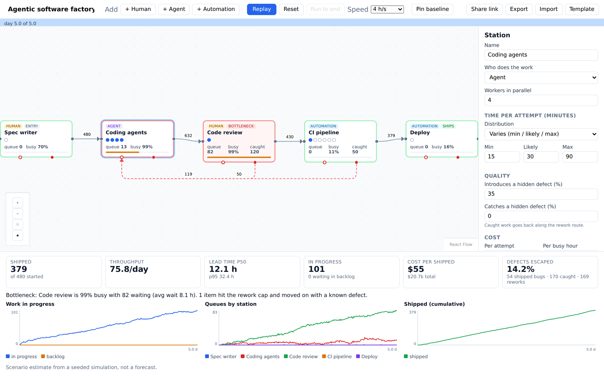
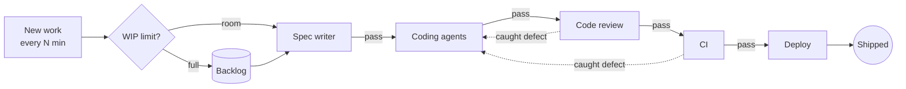

<div align="center">

# 🏭 factorysim

**Sketch a software factory. Press Run. Watch where the work piles up.**

Spec writers, coding agents, reviewers, CI: wire them together on a canvas and watch a deterministic simulation show you throughput, lead time, cost, escaped defects, and the bottleneck. Then change one thing and compare.

No LLMs at runtime, just a seeded discrete-event engine in Rust running as WebAssembly in your browser.




</div>

## What it answers

> *We gave the team four coding agents. Did we ship faster, or did we just move the queue to review?*

The bundled template is a typical agentic pipeline: one spec writer, four coding agents that introduce defects 35% of the time, one human reviewer, CI, and deploy. Code review and CI send caught defects back to the agents.

| | Baseline | + 1 reviewer |
|---|---:|---:|
| Shipped in 5 days | 379 | **438** (+16%) |
| Median lead time | 12.1 h | **4.7 h** (−61%) |
| Cost per shipped item | $55 | **$51** (−6%) |
| Shipped with an escaped defect | 14.2% | 14.2% (no change) |
| Bottleneck | Code review (99% busy, 82 waiting) | Coding agents (99% busy) |

A second reviewer pays for itself, but it only makes review faster: escaped defects don't move, and the new constraint is the agents' rework loop. That's the kind of answer this tool is for.

## Tour

<table>
<tr>
<td width="50%"></td>
<td width="50%"></td>
</tr>
<tr>
<td><b>Watch it run.</b> Work items move along pass routes (grey) and rework routes (red, dashed). Worker dots fill as stations get busy, queues grow, and the bottleneck is flagged.</td>
<td><b>Compare.</b> Finish a run, pin it as the baseline, change one thing, and run again. Every metric shows its delta.</td>
</tr>
<tr>
<td colspan="2"></td>
</tr>
<tr>
<td colspan="2"><b>Edit anything.</b> Each station has workers, time per attempt, the chance it introduces or catches a defect, cost per attempt and per busy hour, and its routes. Connect stations by dragging handles or from the inspector's dropdowns, which work without a mouse.</td>
</tr>
</table>

## Features

- 🧩 **Visual editor**: human, agent, and automation stations; pass and rework routes; drag, connect, and delete with mouse or keyboard
- ▶️ **Live playback** from 15 simulated minutes to 16 simulated hours per second, or run straight to the end
- 📊 **Metrics**: shipped, throughput, lead time p50/p95, WIP and backlog, cost per shipped item including rework, escaped-defect rate, per-station utilization, queue, and wait
- 📈 **Charts** for work in progress, queues by station, and cumulative output
- 📌 **Baseline comparison** with deltas on every metric
- 🔗 **Share links** that hold the whole factory in the URL fragment, so nothing reaches a server, plus JSON import/export and autosave
- 🎲 **Deterministic**: same seed and settings give the same result, natively and in the browser

## Run it

You need Rust with the `wasm32-unknown-unknown` target, `wasm-bindgen-cli` **0.2.129** (it must match the pinned crate), and Node 24.

```sh
rustup target add wasm32-unknown-unknown
cargo install wasm-bindgen-cli --version 0.2.129

cd web
npm install
npm run dev      # builds the wasm engine, then starts Vite
npm run build    # static site in web/dist, deployable to any static host
```

## How the model works



- **Stations** have parallel workers and a time per attempt: constant, or triangular (min / most likely / max).
- **Defects are hidden until caught.** Any station can *introduce* a defect; a station with a catch rate may *detect* one and send the item back along its rework route, where it is fixed. Items that ship with a hidden defect count as **escapes**.
- **Rework cap.** After `maxRework` trips back, caught work is waved through with its defect: it continues along pass routes, is not caught again, and is reported.
- **Routes.** Each station has at most one pass route (none means it ships) and at most one rework route. Rework cycles are fine; loops made only of pass routes are rejected.
- **Arrivals** come at a fixed interval. An optional factory-wide **WIP limit** holds extra work in a backlog.
- **Cost** is a flat charge per attempt plus an hourly rate for busy time.
- **Lead time** runs from arrival to shipping, including time in the backlog.
- **Bottleneck** is the station that is at least 85% busy and has the longest average wait, counting only stations where work actually waits more than a minute.

Results are scenario estimates from one seeded run, not forecasts.

## Determinism

- Time is whole seconds; events are ordered by `(time, sequence)`.
- Each station draws from its own PCG stream, seeded from the scenario seed and the station id, so editing one station does not reshuffle another station's random draws. That keeps before/after comparisons fair.
- Triangular sampling uses only `+ - * /` and `sqrt`, which IEEE 754 rounds identically on native and wasm.
- How the UI slices playback (speed, frame rate, pausing) never changes the outcome; tests check this, including events that land exactly on the horizon.
- Runs stop at a fixed budget of 5 million events so an extreme model can't hang the tab; the app says when that happens and keeps partial runs out of baseline comparisons.

## Tests

```sh
cargo test --workspace   # engine behaviour, validation, golden snapshot
cd web && npm test       # same golden snapshot through the wasm build
```

The template (`fixtures/agentic-factory.json`) must produce exactly `fixtures/agentic-factory.expected.json` both natively and in wasm. If you change engine behaviour on purpose, regenerate it with `UPDATE_GOLDEN=1 cargo test -p factory-sim --test golden` and bump `MODEL_VERSION`.

## Why Rust for the engine and TypeScript for the UI

The engine is the part that has to be right. Rust gives a headless core that's natively testable and can later back a CLI or batch parameter sweeps. For the editor, React Flow provides mature DOM-based nodes, connections, keyboard focus, and pan/zoom. The pure-Rust UI options (egui on a canvas, or Leptos/Dioxus/Yew with a hand-built graph editor) are weaker at text input and accessibility, or would mean building the editor from scratch.

## Project layout

```
crates/factory-sim    engine: model, validation, discrete-event simulation
crates/factory-wasm   wasm-bindgen adapter (JSON in, JS objects out)
fixtures/             bundled template + golden snapshot
web/                  React + React Flow editor, metrics, charts
docs/                 screenshots and demo GIF
```

Saved and shared files use the `factorysim/1` format: `{ format, name, scenario, layout }`.

## Roadmap

- Multi-seed runs with confidence ranges
- Variable arrivals, priorities, and work types
- Shift calendars, per-route buffers, and blocking
- Run the engine in a Web Worker for very large models

## License

MIT, see [LICENSE](LICENSE).
